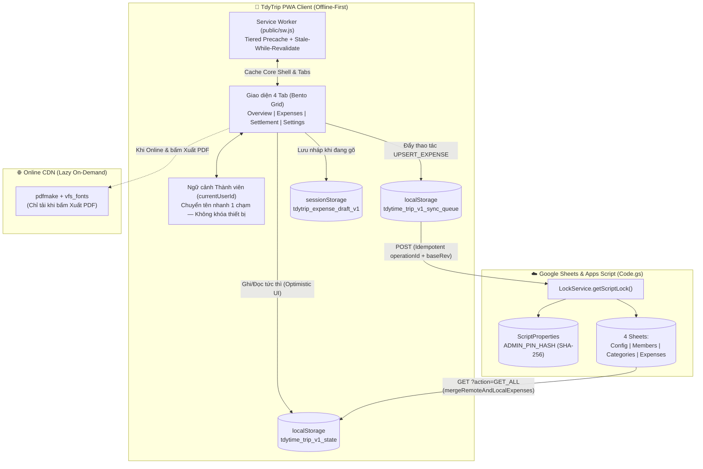
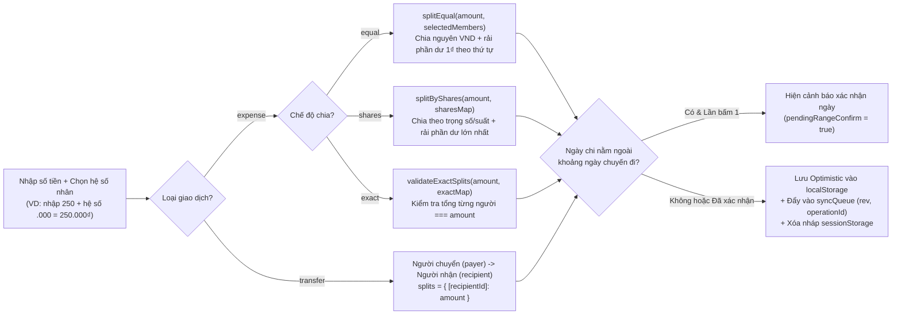
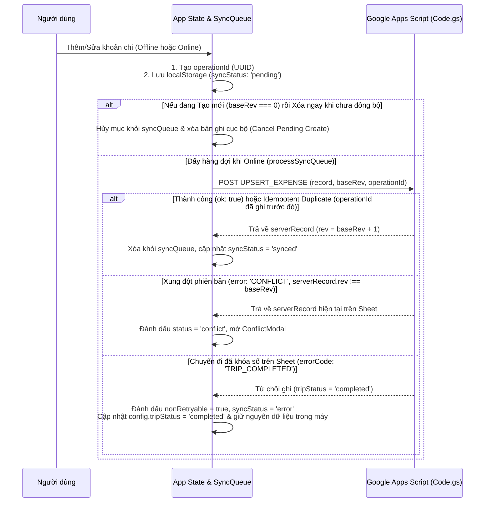

# TdyTrip — Application Feature Map & Verification Guide

> **Chuẩn thiết kế:** Tài liệu này được xây dựng theo cấu trúc **[markphelps/feature-map](https://www.skillsdirectory.com/skills/markphelps-feature-map)** kết hợp sơ đồ luồng trực quan (Mermaid & ASCII), đóng vai trò vừa là **Bản đồ kiến trúc & nghiệp vụ (Product Sitemap)** cho kỹ sư, vừa là **Verification Playbook** để kiểm thử tự động (Playwright / QA Agent) mà không cần dò lại luồng giao diện từ đầu.

---

## 1. Sơ đồ Tổng quan Kiến trúc & Luồng Dữ liệu (System Overview)



---

## 2. Bản đồ Điều hướng & Điểm truy cập (Navigation Sitemap)

| Khu vực / Màn hình | URL / Query Params | Selector / Tương tác mở | File Nguồn Chính |
| :--- | :--- | :--- | :--- |
| **Header — Đổi thành viên** | `?autostart=1` *(bỏ qua modal chọn lần đầu, chọn mặc định `mem_duy`)* | `button[aria-label="Đổi người dùng"]` | `src/App.tsx`, `src/components/WhoAmIModal.tsx` |
| **Header — Đồng bộ nhanh** | Mọi tab | `button[aria-label="Đồng bộ dữ liệu"]` | `src/App.tsx` (`handleRefreshSync`) |
| **Header — Cài đặt PWA** | Mọi tab *(ẩn khi đã cài standalone)* | `button[aria-label="Cài ứng dụng vào điện thoại"]` | `src/components/PWAInstallModal.tsx`, `src/hooks/usePWAInstall.ts` |
| **Header — Giao diện Sáng/Tối** | Mọi tab | `button[aria-label*="chế độ"]` | `src/App.tsx` (`tdytime_theme`) |
| **Tab 1: Tổng quan (Overview)** | `/` hoặc `/?tab=overview` | Bottom Nav: `button` chứa text `"Tổng quan"` | `src/components/OverviewTab.tsx` |
| **Tab 2: Chi tiết (Expenses)** | `/?tab=expenses` | Bottom Nav: `button` chứa text `"Chi tiết"` | `src/components/ExpensesTab.tsx` |
| **Nút Thêm giao dịch (+)** | Mọi tab *(disable khi `completed`)* | Bottom Nav Center FAB: `button[aria-label="Thêm khoản chi mới"]` | `src/components/Navbar.tsx`, `src/components/ExpenseFormModal.tsx` |
| **Tab 3: Chia tiền (Settlement)** | `/?tab=settlement` | Bottom Nav: `button` chứa text `"Chia tiền"` | `src/components/SettlementTab.tsx` |
| **Tab 4: Cài đặt (Settings)** | `/?tab=settings` | Bottom Nav: `button` chứa text `"Cài đặt"` | `src/components/SettingsTab.tsx` |

---

## 3. Chi tiết Từng Tính năng & Workflow (Feature Verification Maps)

---

### Feature 01: Ngữ cảnh Thành viên & Quyền Chỉnh sửa Nhóm Tin Cậy (Trusted Group Context)

#### 1. Mục đích (What it is)
Xác định người dùng hiện tại đang thao tác dưới tên thành viên nào (`currentUserId`). Ứng dụng thiết kế cho nhóm bạn tin cậy: **không dùng tài khoản đăng nhập hay khóa thiết bị (`deviceToken`)**, nhưng phân biệt rõ **Người tạo khoản chi (`createdBy`)** và **Người trả tiền (`payer`)** để tránh sửa nhầm.

#### 2. Sơ đồ Luồng (Workflow)
```text
[Chạm vào 1 khoản chi trong Tab Chi tiết]
       │
       ├── Chuyến đi đã khóa sổ (tripStatus === 'completed')?
       │     └── [CHẶN] Hiện Toast căn giữa: "Chuyến đi đã khóa sổ — Chế độ chỉ xem."
       │
       ├── isAdmin === true HOẶC currentUserId === getExpenseOwnerId(record)?
       │     └── [CHO PHÉP] Mở ngay ExpenseFormModal để chỉnh sửa / xóa
       │
       └── Khoản chi do thành viên khác (ví dụ: B) tạo:
             └── Mở hộp thoại "Chỉnh sửa khoản chi" (Quick Switch / Admin PIN):
                   ├─ Cách 1 (1 chạm): Bấm "Chuyển sang [Tên B] & Sửa ngay" -> Đổi currentUserId = B & mở form sửa
                   └─ Cách 2: Nhập mã PIN Admin -> Mở quyền Admin & mở form sửa
```

#### 3. Cách điều khiển & Kiểm thử (How to Drive)
- **Đổi thành viên trực tiếp:** Click `button[aria-label="Đổi người dùng"]` trên thanh Header → Chọn thành viên trong `div[role="dialog"][aria-labelledby="whoami-modal-title"]`.
- **Chuyển nhanh khi bấm vào khoản chi của người khác:**
  1. Vào `/?tab=expenses`.
  2. Click vào một khoản chi có biểu tượng ổ khóa (`Lock` icon - khoản chi do người khác tạo).
  3. Trong dialog `div[aria-labelledby="quick-admin-pin-title"]`, bấm nút `"Chuyển sang [Tên] & Sửa ngay"`.

#### 4. Kết quả kỳ vọng (Expected Observations)
- `localStorage.getItem('tdytime_trip_v1_user')` cập nhật sang ID thành viên mới.
- Toast căn giữa hiển thị: `"Đã chọn: [Tên thành viên]"`.
- Biểu mẫu `ExpenseFormModal` mở ra ngay lập tức với dữ liệu của khoản chi vừa chọn.

#### 5. Bẫy & Quy tắc bất biến (Gotchas & Invariants)
- **Phân biệt `createdBy` và `payer`:** Người A có thể nhập hộ một khoản chi do Người B trả tiền (`createdBy = A`, `payer = B`). Quyền sửa mặc định thuộc về `createdBy` (`getExpenseOwnerId(record)` ưu tiên `record.createdBy`, chỉ fallback về `record.payer` với dữ liệu lịch sử cũ không có `createdBy`).
- Không bao giờ lưu hay kiểm tra `deviceToken` / `creatorToken`.

---

### Feature 02: Tab Tổng quan — Bento Grid Dashboard (`OverviewTab`)

#### 1. Mục đích (What it is)
Hiển thị bức tranh tài chính toàn cảnh của chuyến đi và số dư cá nhân của thành viên đang chọn theo bố cục Bento Grid tối giản.

#### 2. Cấu trúc Hiển thị & Quy tắc Căn lề (Layout & Alignment Rules)
```text
┌──────────────────────────────────────────────────────────┐
│ ▶ ĐÀ LẠT · 4N3Đ                       01/11 – 04/11/2026 │
│ Tổng chi toàn đoàn                          12.500.000 ₫ │ <-- Số lớn căn phải (text-right)
│ ──────────────────────────────────────────────────────── │
│ 8 khoản · 5 người               Bình quân: ~2.500.000/ng │ <-- Tiền bình quân căn phải
└──────────────────────────────────────────────────────────┘
┌──────────────────────────────────────────────────────────┐
│ [Avatar] Duy  [CẦN NHẬN]                     Chia tiền > │
│ Tổng cần nhận                               +1.250.000 ₫ │ <-- Số lớn căn phải (text-right)
│ ──────────────────────────────────────────────────────── │
│ Đã chi: 3.750.000                    Phải chịu: 2.500.000│
└──────────────────────────────────────────────────────────┘
┌───────────────────────────┐  ┌───────────────────────────┐
│ THEO DANH MỤC             │  │ THEO NGÀY                 │
│ 🍜 Ăn uống    45% 5.625.000│  │ Ngày 1 (01/11) 60% 7.500k│
└───────────────────────────┘  └───────────────────────────┘
```

#### 3. Cách điều khiển & Kiểm thử (How to Drive)
- Truy cập `/?tab=overview`.
- Bấm `"Chia tiền >"` trên thẻ cá nhân để chuyển nhanh sang `/?tab=settlement`.
- Bấm `"Chi tiết >"` ở tiêu đề mục Thống kê để chuyển sang `/?tab=expenses`.

#### 4. Kết quả kỳ vọng (Expected Observations)
- Chỉ tính các bản ghi có `!e.deleted && e.type === 'expense'` vào **Tổng chi toàn đoàn**, **Bình quân/người**, **Theo danh mục**, và **Theo ngày**.
- Các giao dịch `type === 'transfer'` (chuyển khoản riêng) chỉ tác động vào `myBalance.netTransfer` và `myBalance.balance`, tuyệt đối không làm tăng tổng chi tiêu của đoàn.
- Mọi con số liên quan đến tiền tệ (bao gồm 2 số lớn ở Hero Card và User Card) đều căn phải (`text-right tabular-nums`).

---

### Feature 03: Thêm / Sửa / Xóa Khoản chi & Chuyển tiền (`ExpenseFormModal`)

#### 1. Mục đích (What it is)
Biểu mẫu nhập liệu tốc độ cao trên di động hỗ trợ 2 loại giao dịch (**Chi tiêu chung `expense`** và **Chuyển tiền riêng `transfer`**), 3 chế độ chia tiền (`equal`, `shares`, `exact`), gợi ý nhân mệnh giá (`x1.000`, `x10.000`, `x100.000`) và tự động lưu nháp (`sessionStorage`).

#### 2. Sơ đồ Luồng Chia tiền & Lưu trữ (Workflow)


#### 3. Cách điều khiển & Kiểm thử (How to Drive)
- Mở modal: Click `button[aria-label="Thêm khoản chi mới"]`.
- Chọn loại giao dịch: Nút `"Chi tiêu"` hoặc `"Chuyển khoản"`.
- Nhập tên khoản chi: `input[name="expenseTitle"]`.
- Nhập số tiền: `input[name="expenseAmount"]` (chỉ nhận chữ số, kết hợp chip hệ số nhân bên dưới).
- Chọn chế độ chia: `"Chia đều"`, `"Theo suất"`, hoặc `"Nhập số"`.
- Bấm nút submit `"Lưu khoản chi"` / `"Cập nhật"`.
- **Xóa mềm (Soft Delete):** Khi đang sửa khoản chi (`editingRecord !== null`), bấm nút thùng rác `"Xóa"` → Bấm xác nhận `"Xác nhận xóa"` (2 bước chống bấm nhầm).

#### 4. Kết quả kỳ vọng (Expected Observations)
- Tổng các giá trị trong `record.splits` luôn khớp chính xác 100% với `record.amount` (không bao giờ lệch 1₫ do làm tròn).
- Số tiền đọc bằng chữ tiếng Việt hiển thị ngay dưới ô nhập tiền (`readVietnameseNumber`).
- Khi đang nhập mới mà vô tình tải lại trang, mở lại modal sẽ tự động khôi phục dữ liệu từ `sessionStorage` (`tdytrip_expense_draft_v1`).

#### 5. Bẫy & Quy tắc bất biến (Gotchas & Invariants)
- Nếu ngày chi tiêu (`spentAt`) nằm trước `config.startDate` trên 30 ngày hoặc sau `config.endDate` trên 7 ngày, lần bấm Lưu đầu tiên sẽ hiển thị hộp cảnh báo màu vàng (`pendingRangeConfirm`); bấm Lưu lần thứ 2 mới thực sự ghi nhận.
- Khi `config.tripStatus === 'completed'`, cả nút mở modal lẫn hàm `handleSaveExpenseRecord` và `handleSoftDeleteExpense` đều chặn cứng và hiện Toast căn giữa.

---

### Feature 04: Danh sách Chi tiết, Tìm kiếm & Lọc (`ExpensesTab`)

#### 1. Mục đích (What it is)
Hiển thị danh sách giao dịch gom nhóm theo từng ngày chuyến đi (`Ngày 1`, `Ngày 2`, `Trước chuyến đi`), hỗ trợ tìm kiếm tiếng Việt bỏ dấu, lọc theo danh mục/người trả, xem khoản đã xóa và tải tăng dần (Progressive Rendering 100 khoản/lần).

#### 2. Cách điều khiển & Kiểm thử (How to Drive)
- Truy cập `/?tab=expenses`.
- **Tìm kiếm:** Gõ vào `input[name="expense-search"]` (hỗ trợ gõ không dấu, ví dụ gõ `"ca phe"` tìm thấy `"Cà phê"` nhờ `normalizeSearchText`).
- **Lọc danh mục:** Chọn trong `select[name="category-filter"]` (`all`, `__transfer__`, hoặc ID danh mục).
- **Lọc người trả:** Chọn trong `select[name="member-filter"]`.
- **Xem khoản đã xóa:** Khi có ít nhất 1 khoản bị xóa mềm (`deleted: true`), nút `"Đã xóa (N)"` sẽ xuất hiện để bật/tắt hiển thị các dòng gạch ngang.

#### 3. Kết quả kỳ vọng (Expected Observations)
- Tổng tiền hiển thị ở tiêu đề mỗi nhóm ngày (`group.totalExpense`) luôn được tính trên **toàn bộ khoản chi hợp lệ của ngày đó** (không bị thiếu hụt khi danh sách đang phân trang ở mốc 100 mục).
- Mỗi dòng hiển thị rõ trạng thái đồng bộ nếu chưa lên Sheet:
  - `pending` / `syncing`: Nhãn vàng `"Chờ đồng bộ lên Sheet"`.
  - `conflict`: Nhãn đỏ `"Xung đột phiên bản (Chưa lên Sheet)"`.
  - `error`: Nhãn đỏ `"Chưa lên Sheet (Chuyến đi đã khóa sổ)"` hoặc `"Chưa lên Sheet (Lỗi đồng bộ)"`.

---

### Feature 05: Quyết toán & Tối ưu Công nợ (`SettlementTab`)

#### 1. Mục đích (What it is)
Tính toán số dư ròng (`balance = paidExpense - owedExpense + netTransfer`) của từng thành viên và đề xuất danh sách chuyển khoản thanh toán kèm nút copy nhanh **Số tài khoản** và **Số tiền nguyên bản**.

#### 2. Sơ đồ Thuật toán Quyết toán (Workflow)
```text
[Dữ liệu Expenses & Transfers]
       │
       ▼
calculateBalances(members, expenses)
  • paidExpense: Tổng tiền thành viên đã chi hộ đoàn
  • owedExpense: Tổng phần tiền thành viên phải chịu
  • netTransfer: Tiền đã chuyển riêng (+) trừ tiền đã nhận riêng (-)
  • balance = paidExpense - owedExpense + netTransfer
       │
       ├── Chế độ "Tối giản" (Mặc định - simplifyDebts):
       │     └── Thuật toán Greedy ghép Người thiếu nhiều nhất -> Người dư nhiều nhất
       │         (Tối thiểu hóa số lần chuyển khoản trong nhóm)
       │
       └── Chế độ "Từng cặp" (calculatePairwiseDebts):
             └── Bù trừ trực tiếp nợ đôi một giữa từng cặp 2 người (A <-> B)
```

#### 3. Cách điều khiển & Kiểm thử (How to Drive)
- Truy cập `/?tab=settlement`.
- Chuyển đổi chế độ xem: Bấm nút `"Tối giản"` (`aria-pressed`) hoặc `"Từng cặp"`.
- Trên mỗi thẻ giao dịch cần chuyển:
  - Bấm `"Copy STK"`: Sao chép chuỗi số tài khoản của người nhận.
  - Bấm `"Copy Số tiền"`: Sao chép chuỗi số nguyên của khoản cần chuyển.

#### 4. Kết quả kỳ vọng (Expected Observations)
- Tổng đại số `sumOfBalances` của cả đoàn luôn bằng `0`.
- Các thẻ giao dịch có liên quan đến thành viên đang chọn (`currentUserId`) được làm nổi bật bằng viền `border-2 border-brand` và nhãn `"Bạn chuyển"` / `"Bạn nhận"`.

#### 5. Bẫy & Quy tắc bất biến (Gotchas & Invariants)
- **Quy tắc Copy Ngân hàng nghiêm ngặt:**
  - Nút `"Copy STK"` chỉ copy duy nhất chuỗi ký tự số tài khoản đã làm sạch khoảng trắng và dấu nháy đơn đầu dòng (giữ nguyên số `0` ở đầu như `"0011004567890"`), tuyệt đối không kèm tên ngân hàng.
  - Nút `"Copy Số tiền"` chỉ copy chuỗi số nguyên liền mạch (ví dụ `"2500000"`), tuyệt đối không có dấu chấm phân cách hay ký hiệu `₫` để dán trực tiếp vào ứng dụng Mobile Banking.

---

### Feature 06: Đồng bộ Hai chiều Google Sheets, Hàng đợi Offline & Xử lý Xung đột (`syncService`)

#### 1. Mục đích (What it is)
Đảm bảo ứng dụng hoạt động mượt mà khi không có mạng (Offline-first), tự động đẩy hàng đợi `syncQueue` lên Google Sheets khi có mạng lại, chống nhân đôi giao dịch khi mạng timeout (`Idempotency`) và bảo vệ xung đột phiên bản (`rev`).

#### 2. Sơ đồ Luồng Đồng bộ & Hợp nhất (Sync & Reconcile State Machine)


#### 3. Cách điều khiển & Kiểm thử (How to Drive)
- **Giả lập Offline:** Vào `/?tab=settings` → tab con `"Hệ thống"` → Bật công tắc `"Giả lập Offline"` (hoặc ngắt mạng trình duyệt).
- Thêm/sửa khoản chi → Quan sát thanh cảnh báo màu vàng xuất hiện ở đầu màn hình hiển thị danh sách hàng đợi `syncQueue`.
- **Kiểm thử Xung đột (Conflict Modal):** Vào `/?tab=settings` → `"Hệ thống"` → Mở khóa Admin PIN → Bấm nút `"Test xung đột"` (`onTriggerDemoConflict`).
  - Trong `ConflictModal`, chọn 1 trong 2 hướng giải quyết:
    1. `"Lấy bản trên Sheet"` (`handleAcceptServerVersion`): Hủy bản sửa cục bộ, nhận dữ liệu mới nhất từ Sheet.
    2. `"Ghi đè bản của tôi"` (`handleForceKeepClientVersion`): Nâng `baseRev = serverRecord.rev` và đẩy lại lên Sheet thành `rev + 1`.

#### 4. Bẫy & Quy tắc bất biến (Gotchas & Invariants)
- **Bảo vệ chỉnh sửa đang diễn ra (In-flight Edit Protection):** Hàm `mergeRemoteAndLocalExpenses(remoteExpenses, localQueue)` kiểm tra cả `operationId` và mốc thời gian `updatedAt`. Nếu người dùng sửa tiếp một khoản chi ngay trong lúc yêu cầu đồng bộ trước đó đang bay trên mạng, bản sửa mới hơn ở máy khách sẽ không bị dữ liệu cũ từ mạng ghi đè.
- **Chống vòng lặp Retry vô hạn:** Các lỗi nghiệp vụ có `nonRetryable: true` (như `TRIP_COMPLETED`, `PERMISSION_DENIED`) sẽ không tự động chạy exponential backoff retry, giúp tiết kiệm pin và băng thông.

---

### Feature 07: Quản trị Chuyến đi, Khóa sổ & Xuất Báo cáo PDF (`SettingsTab`)

#### 1. Mục đích (What it is)
Cung cấp công cụ cho Admin quản lý thành viên, STK ngân hàng, danh mục chi tiêu, thông tin chuyến đi, khóa sổ khi kết thúc hành trình và xuất báo cáo quyết toán ra file PDF tiếng Việt.

#### 2. Sơ đồ Luồng Khóa sổ & Xuất PDF (Workflow)
```text
[Tab Cài đặt (/?tab=settings)]
  ├── Mục 1: Thành viên (Copy STK mở cho mọi người; Thêm/Sửa/Xóa cần mở Admin PIN)
  ├── Mục 2: Chuyến đi (Tên, Địa điểm, Ngày, Chế độ chia, Trạng thái Đang mở / Đã khóa sổ)
  │     └── Nếu bấm "Lưu" để Khóa sổ khi còn hàng đợi chưa đồng bộ (pendingSyncCount > 0):
  │           └── Hiện hộp cảnh báo xác nhận (confirmLockWithPending):
  │                 ├─ "Đồng bộ ngay trước khi khóa"
  │                 ├─ "Vẫn khóa sổ (giữ hàng đợi)"
  │                 └─ "Hủy"
  └── Mục 3: Hệ thống
        ├─ Mở khóa Admin PIN (Mặc định: 2026 | Xác thực SHA-256 trên GAS khi Online)
        ├─ Kết nối Google Sheet URL + Copy mã nguồn Code.gs + Copy Link mời nhóm (?gas=...)
        └─ Xuất Báo cáo PDF (Lọc theo Tất cả hoặc Từng thành viên -> Tải pdfmake qua CDN)
```

#### 3. Cách điều khiển & Kiểm thử (How to Drive)
- **Mở quyền Admin:** Vào `/?tab=settings` → Bấm tab con `"Hệ thống"` → Nhập mã PIN (mặc định `2026`) vào `input[name="adminPin"]` → Bấm `"Mở khóa"`.
- **Khóa / Mở khóa sổ chuyến đi:** Sau khi mở Admin, chuyển sang tab con `"Chuyến đi"` → Bấm nút trạng thái `"Đang mở"` / `"Đã khóa sổ"` → Bấm `"Lưu"`.
- **Xuất báo cáo PDF:** Ở tab con `"Hệ thống"`, chọn thành viên trong bộ lọc báo cáo → Bấm nút `"Tải báo cáo PDF"`.

#### 4. Kết quả kỳ vọng (Expected Observations)
- Khi chuyển sang `"Đã khóa sổ"`:
  - Thanh thông báo đen căn giữa `"Chuyến đi đã kết thúc — Chế độ chỉ xem."` xuất hiện ở đầu màn hình trên mọi tab.
  - Nút dấu cộng (`+`) ở thanh điều hướng dưới cùng chuyển sang trạng thái khóa (`disabled`).
- Khi bấm `"Tải báo cáo PDF"` lúc đang Offline: Hệ thống chặn tải CDN và báo rõ `"Cần kết nối Internet để xuất báo cáo PDF"`, giữ nguyên trải nghiệm Offline cho các tính năng khác.

---

### Feature 08: Quản lý Phiên bản Tự động & PWA Lifecycle (`version.ts` & `sw.js`)

#### 1. Mục đích (What it is)
Đảm bảo mọi thiết bị trong nhóm luôn chạy đúng phiên bản mới nhất với quy chuẩn định dạng `v[yyyymmdd_HHmm]` (GMT+7) và hỗ trợ chạy Offline thông qua Service Worker.

#### 2. Sơ đồ Cơ chế Đồng bộ Phiên bản (Version Lifecycle)
```text
src/version.ts (APP_VERSION = 'v[yyyymmdd_HHmm]')
       │
       ├── [Khi chạy vite dev / vite build (vite.config.ts)]
       │     ├── Tự động ghi public/version.json: { "version": "v..." }
       │     ├── Tự động cập nhật CACHE_NAME trong public/sw.js
       │     └── [Khi build] Tự động chèn danh sách Core Shell chunks vào PRECACHE_ASSETS của dist/sw.js
       │
       └── [Khi người dùng mở App / Bấm nút Đồng bộ / Có mạng lại / Chu kỳ 30 phút]
             └── checkRemoteVersion() tải /version.json?t=... (no-store)
                   └── Nếu remoteVersion > APP_VERSION:
                         └── Hiện nút thông báo nổi bật: "Có phiên bản mới. Bấm để cập nhật."
                               └── Khi bấm: Xóa Service Worker & Cache cũ -> window.location.reload()
```

---

## 4. Danh mục Kiểm thử Tự động (Automated Verification Suite)

Khi thay đổi logic nghiệp vụ hoặc giao diện, chạy các lệnh sau để xác minh toàn bộ các ràng buộc trong Feature Map:

```bash
# 1. Kiểm thử Unit & Contract (21 tests: Chia tiền, Quyết toán, PDF Data, Sync Queue, Khóa sổ, Quyền sửa)
npx tsx --test src/utils/math.test.ts src/utils/pdfReport.test.ts src/services/syncService.test.ts

# 2. Kiểm tra kiểu dữ liệu TypeScript
npm run lint

# 3. Kiểm tra đóng gói Production & Tiered Precache Injection
npm run build
```
